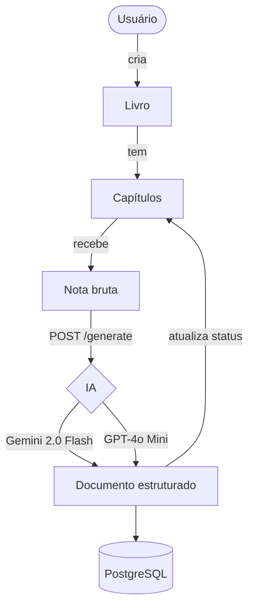
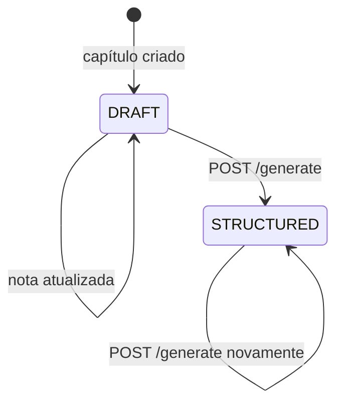
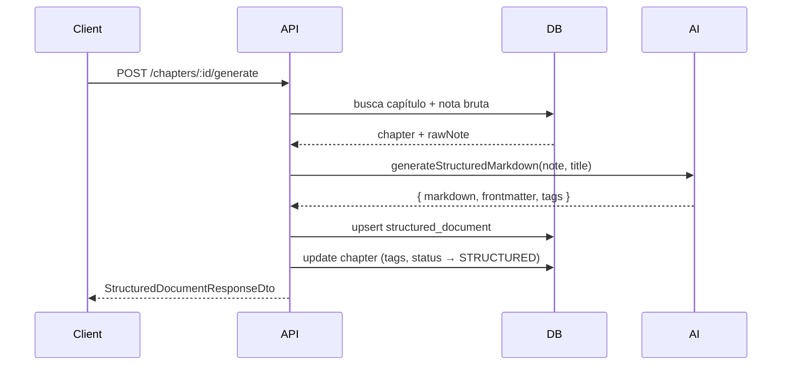

# Take Notes

> Transforme anotações brutas de estudo em documentos estruturados prontos para RAG, usando IA.

---

## O que é

Take Notes é uma API que ajuda você a organizar seu material de estudo e gerar documentos Markdown estruturados automaticamente. Você escreve suas notas livremente, a IA transforma em um documento com hierarquia, tags e frontmatter — pronto para ser indexado em qualquer sistema de busca semântica.

---

## Fluxo principal



---

## Ciclo de vida de um capítulo



---

## Como a geração funciona

Ao chamar `POST /chapters/:chapterId/generate`:



---

## Setup rápido

```bash
# 1. instalar dependências
yarn install

# 2. configurar variáveis de ambiente
cp .env.example .env
# edite o .env com suas credenciais

# 3. rodar migrations
npx prisma migrate dev

# 4. subir em modo dev
yarn start:dev
```

Variáveis necessárias no `.env`:

```env
DATABASE_URL=postgresql://<user>:<password>@<host>:<port>/<database>
AI_PROVIDER=gemini        # ou "openai"
GEMINI_API_KEY=<sua-chave>
OPENAI_API_KEY=<sua-chave>
```

---

## Stack

- **NestJS 11** + TypeScript
- **Prisma 6** + PostgreSQL
- **Google Gemini 2.0 Flash** (padrão) ou **OpenAI GPT-4o Mini**
- Clean Architecture por bounded context

Para detalhes completos de arquitetura, endpoints e banco de dados, veja [`docs/DOCUMENT.md`](./docs/DOCUMENT.md).
